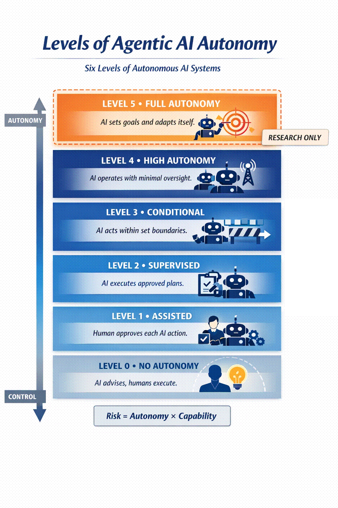
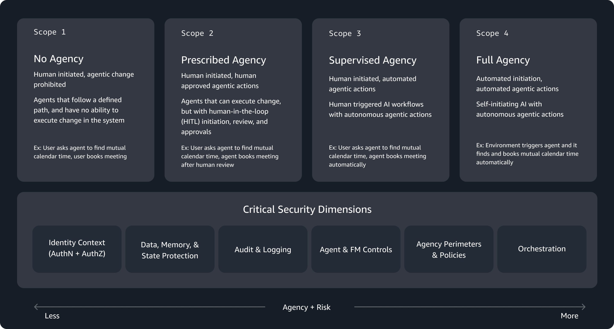

## Agentic Autonomy Level Taxonomy - CSA
Link: https://cloudsecurityalliance.org/blog/2026/01/28/levels-of-autonomy
This is a framework to use in what level can be an LLM autonomous in desicions and actions consist in six levels using the structure of SAE J3016:

Level 0: No Autonomy (Human Execution):
AI system provides information, analysis, or recommendations, but humans perform all actions.

Level 1: Assisted (Human Decision + AI Execution)
AI can execute actions, but each action requires explicit human approval before execution.

Level 2: Supervised (Human Approval + Batch Execution)
Instead of approving each individual action, humans review and approve a plan or batch of actions, and the AI then executes autonomously within that approved scope. (higher level of abstaraction need to b revoew from the user)

Level 3: Conditional (AI Decision within Boundaries)
AI makes decisions and takes actions autonomously within defined boundaries, escalating to humans only when it encounters situations that exceed those boundaries.

Level 4: High Autonomy (Minimal Supervision)
AI operates autonomously across a broad scope, with human involvement shifting from decision approval to monitoring and exception handling. Humans don't approve actions or even define narrow boundaries. They watch for anomalies and intervene when something appears wrong.

Level 5: Full Autonomy (Self-Directed)
AI operates with only strategic oversight from humans.

## Agentic Autonomy Level Taxonomy - CSA
link: https://www.aurorasre.ai/blog/cicd-auto-remediation-complete-guide
this is a autonomy level when a pipeline fails in a deploy (rollback)
L0. Manual
L1. Automated Rollback (without AI): rollback automated without an LLM, only automated steps
L2. Rollback + Diagnostic:
same as L1, but LLM search all the logs and diagnosis to deliver a RCA with an alert

L3. Rollback + Diagnostic + Remediation
same as l2, but now the LLM create a remediation and opne a PR waiting to a human in the loop 

L4. Closed-Loop with Policy Gates
same as L3 but LLM close all the cycle with policies on it

## OWASP DevSecOps Guideline — Vulnerability Management
link: https://owasp.github.io/DevSecOpsGuideline/2-Process/2-7-Operate/2-7-4-Vulnerability-Management/#maturity-progression

this is more a standard to create findings from vulnerabilities findings and how to structure them
Starter — Centralize findings from SAST and SCA into DefectDojo. Apply CVSS-based SLAs. Assign findings to development teams. Track open critical/high counts weekly.

Intermediate — Enrich findings with EPSS and KEV data for prioritization. Automated ticket creation and assignment by code ownership. VEX for the top 10 most-flagged false-positive CVEs. SLA adherence tracked and reported to leadership.

Advanced — Full ASPM platform with code-to-runtime context. AI-assisted remediation PRs for known vulnerability patterns. Automated VEX generation from call-graph reachability analysis. Real-time SLA breach escalation. Vulnerability aging and recurrence analytics in the engineering KPI dashboard.

## Agentic AI Security Scoping Matrix
link: https://aws.amazon.com/ai/security/agentic-ai-scoping-matrix/
Scope 1. No Agency: 
Scope 2. Prescribed Agency:
HUman in the loop, aprroved agentic actions
Scope 3. SUpervisedAgency:
Human initatited, auomated agentic actions 
Scope 4. Full agency:
Automated intitiaion, automated agentic action

# Tabla comparativa 
